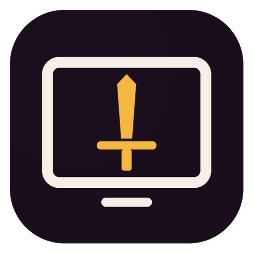
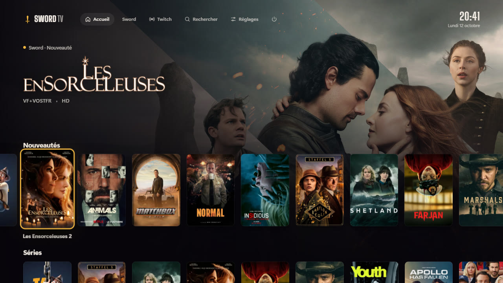
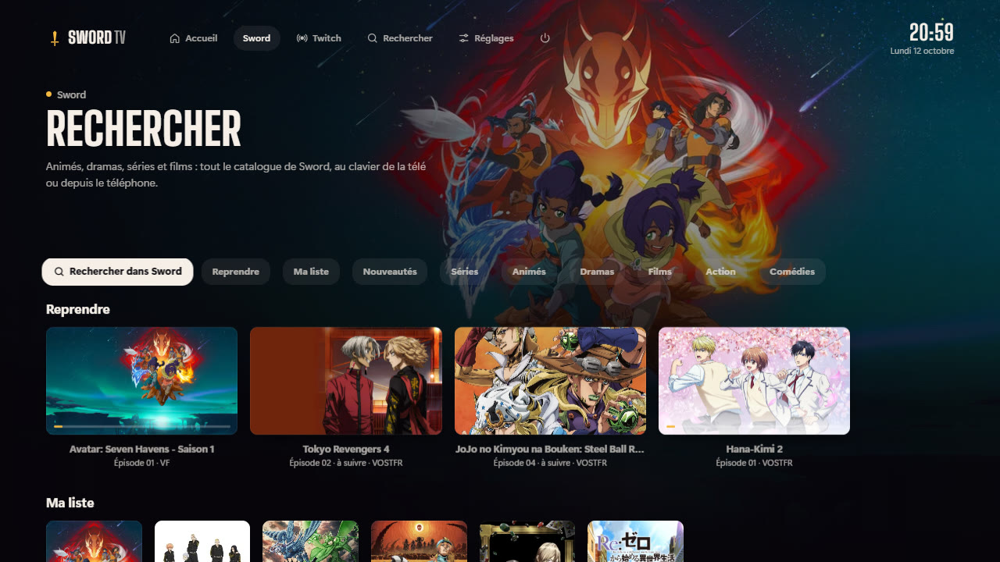
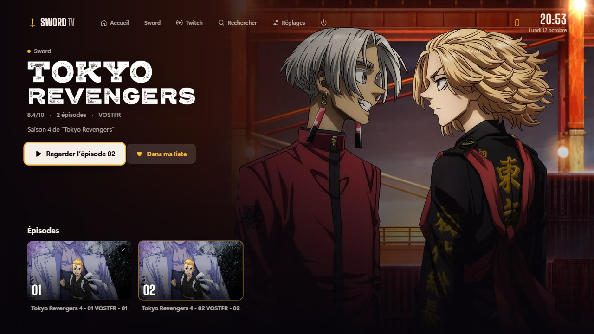
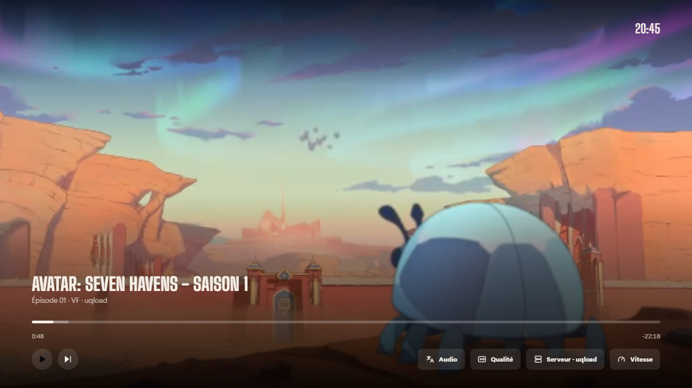
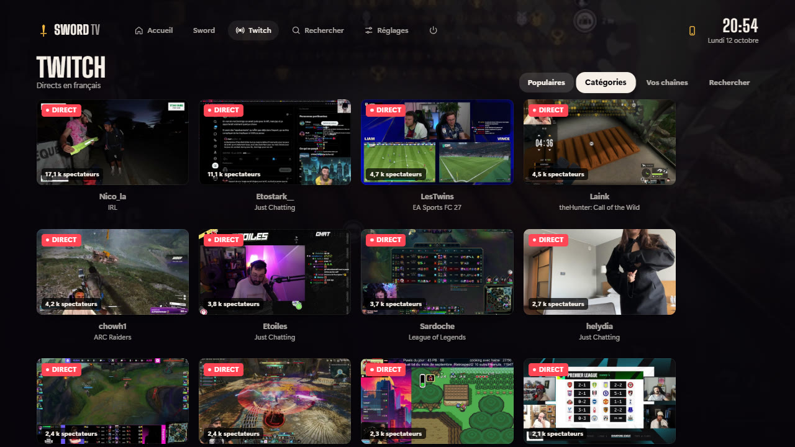
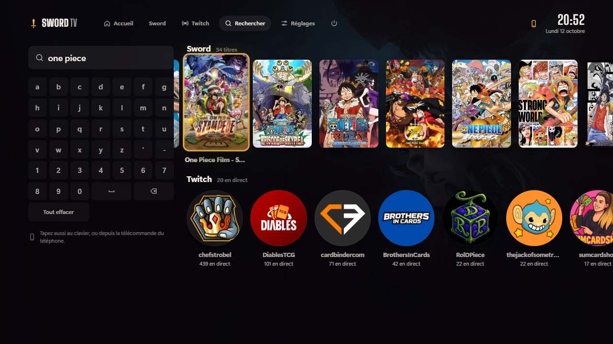

<h1 align="center">Sword TV</h1>

<b>Votre PC devient une Smart TV.</b> 
Sword, YouTube, Twitch, Netflix, Prime Video, Disney+… en plein écran, à la télécommande.

<a href="https://github.com/pixl27/Sword-TV/releases/latest/download/Installer-Sword-TV.exe"><b>⬇️ Télécharger Sword TV pour Windows</b></a>

## Installer

1. Téléchargez **[Installer-Sword-TV.exe](https://github.com/pixl27/Sword-TV/releases/latest/download/Installer-Sword-TV.exe)**.
2. Double-cliquez dessus. Pas de question, pas de droits administrateur : Sword TV s’installe et s’ouvre en plein écran.
3. Si Windows affiche « Windows a protégé votre ordinateur » : **Informations complémentaires**, puis **Exécuter quand même**.
4. Au premier lancement, Windows demande d’autoriser Sword TV sur le réseau : **acceptez** (réseau privé), c’est ce qui permet au téléphone de servir de télécommande.

Un raccourci **Sword TV** est posé sur le Bureau et dans le menu Démarrer. Pour désinstaller : *Paramètres › Applications installées › Sword TV*.

**Mises à jour** : Sword TV vérifie tout seul s’il existe une nouvelle version et vous la propose. *Réglages › Mises à jour*, OK : il la télécharge, l’installe et redémarre.

## La télécommande, c’est votre téléphone

Dans **Réglages › Télécommande**, scannez le QR code avec le téléphone — ou tapez simplement le lien affiché (par exemple `http://192.168.1.20`) et entrez le code à 4 chiffres qui apparaît sur la télé. Le téléphone et le PC doivent être sur le même Wi-Fi.

Glissez sur le pavé pour vous déplacer, touchez pour valider. Retour, Accueil, Lecture/Pause, **volume du PC**, clavier (avec la dictée du téléphone) et menu d’alimentation. Astuce : ajoutez la page à l’écran d’accueil du téléphone.

**Manette** Xbox ou PlayStation : A valider, B retour, Y rechercher, Start lecture, Guide accueil.
**Clavier** : flèches, Entrée, Échap. **F11** bascule plein écran / fenêtre.

## Ce qu’il y a dedans

| | |
| --- | --- |
|  | **Sword** — animés, dramas, séries et films, avec sa propre recherche, « Reprendre », Ma liste, les logos et les fonds des œuvres. |
|  | **Fiches** — le bon épisode est déjà choisi (reprendre, suivant), photos et titres des épisodes, VF / VOSTFR. |
|  | **Lecteur** — reprise là où vous en étiez, avance rapide, générique sauté, épisode suivant automatique, changement de serveur si l’un tombe, minuterie de mise en veille. |
|  | **Twitch** — les directs du moment, les catégories, vos chaînes, sa propre recherche. Haut/bas pour zapper, le chat à côté de l’image. |
|  | **Recherche** — un clavier pensé pour la télécommande, ou tapez depuis le téléphone. |

Et aussi : **YouTube** dans sa version télé (connexion via yt.be/activate) ; **Netflix, Prime Video, Disney+, Crunchyroll, YouTube Music** ouverts en plein écran dans Microsoft Edge ; **Steam Big Picture**, **Spotify**, **VLC**, **Kodi** s’ils sont installés ; économiseur d’écran ; démarrage automatique avec Windows ; choix de l’écran (la télé).

## Configuration

Windows 10 ou 11 (64 bits). Microsoft Edge (déjà présent sur Windows) pour Netflix, Prime Video et Disney+.
